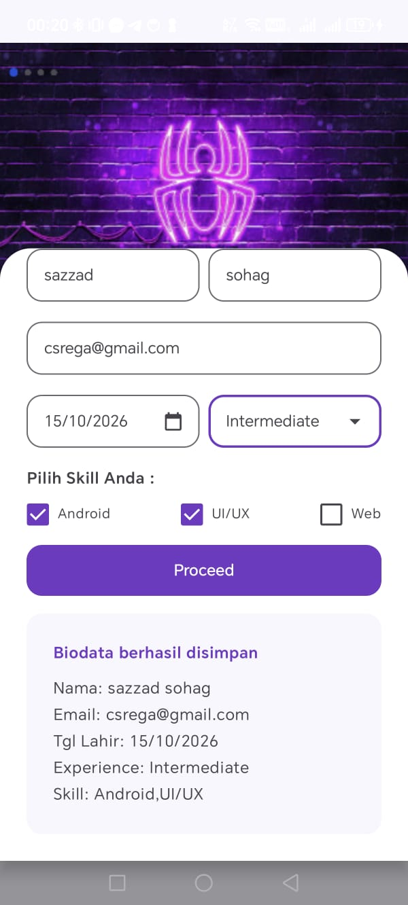
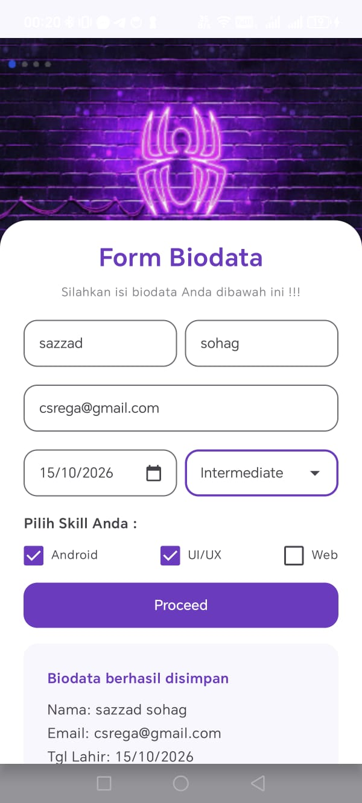

# QuestTugasUserInput_0253

QuestTugasUserInput_0253 is a native Android biodata form built with Kotlin and Jetpack Compose. It reproduces the supplied reference layout with a neon spider banner, floating form panel, resource-backed styling, and functional form interactions.

## Technology stack

- Kotlin
- Jetpack Compose and Material 3
- Android Gradle Plugin and Gradle wrapper
- Android XML resources for text, colors, dimensions, and vector icons

## Features

- First name, last name, and email inputs
- Email keyboard configuration and validation feedback
- Date-of-birth picker that rejects future dates
- Resource-defined Beginner, Intermediate, and Advanced experience options
- Independent Android, UI/UX, and Web skill checkboxes
- Disabled Proceed button until the form is valid
- Inline submitted-data panel after valid submission
- Scrollable, IME-aware form panel

## Project structure

- `app/src/main/java/.../BiodataScreen.kt` contains the Compose screen and form behavior.
- `app/src/main/res/values/` contains strings, colors, dimensions, and the application theme.
- `app/src/main/res/drawable/` contains the supplied neon spider banner and local vector icons.
- `app/src/androidTest/` contains Compose interaction tests.

## Run the project

Open the project in Android Studio, allow Gradle sync to complete, select an emulator or connected device, and run the `app` configuration.

For a command-line debug build on Windows:

```powershell
.\gradlew.bat assembleDebug
```

Run local unit tests with:

```powershell
.\gradlew.bat testDebugUnitTest
```

Compile the Compose instrumentation APK with:

```powershell
.\gradlew.bat assembleDebugAndroidTest
```

## Layout and validation

The main screen uses a `Scaffold` containing a `Box`. The banner is the rear layer and the white rounded form panel is overlaid above it, satisfying the required floating Box structure. The Proceed button remains disabled until all required fields are valid and at least one skill is selected.

All visible application text, custom colors, reusable dimensions, dropdown entries, and result copy are stored in Android resources.

## Running application screenshots





These screenshots show the application running with a completed form and the submitted-data panel displayed below the form.

## Verification status

The final available verification completed successfully:

- `testDebugUnitTest`
- `assembleDebug`
- `assembleDebugAndroidTest`
- `lintDebug`

Runtime instrumentation execution still requires an available Android emulator in this environment.
